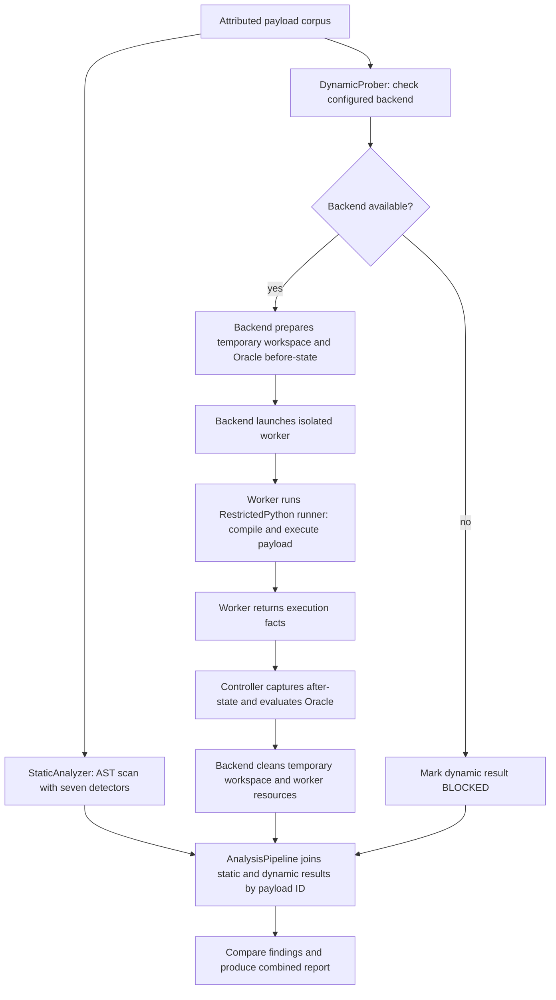

# SandboxEscapeFinder

Static analysis and isolated dynamic testing of Python sandbox escape techniques.
This is my implementation of [Task 6](https://github.com/SeekingDream/ProgrammingTask/blob/master/06_sandbox_escape_finder.md)
from the ProgrammingTask repository. The dynamic target is the real, unmodified
[RestrictedPython](https://github.com/zopefoundation/RestrictedPython) package.

The tool answers two questions: does a source snippet contain a known escape
pattern, and does running it produce an effect that the oracle can observe?
A static finding is evidence of suspicious syntax. A confirmed escape requires
an observed effect; an exception or successful execution alone is insufficient.

## Run with Docker

Install Docker Desktop, start it, and select **Linux containers**. Building needs
internet access to download the pinned image and dependencies. The run commands
below disable networking and do not mount your files or the Docker socket.

```powershell
git clone https://github.com/aynaakhann/sandbox_escape_finder.git
cd sandbox_escape_finder
docker build -t sandbox-escape-finder:latest .
docker run --rm --network none --read-only --tmpfs /tmp:rw,size=64m,mode=1777 --cap-drop ALL --security-opt no-new-privileges --memory 512m --cpus 1 --pids-limit 64 sandbox-escape-finder:latest
```

The default command runs the 19-case corpus and prints a summary, a per-payload
table, and the static/dynamic comparison. The container exits when it finishes;
this project is a command-line tool and has no web server or port to open.
Starting the image in Docker Desktop also runs the probe, but the terminal
command applies the additional containment settings shown above.

### What has been verified

On the maintainer's tested setup (Docker Desktop 29.8.2 using Linux containers,
CPython 3.13, and RestrictedPython 8.5), both Docker images built successfully.
The core suite completed with 110 passed and 9 deselected; the host-orchestrated
Docker suite completed with 9 passed and 110 deselected. The application image
and quickstart also ran successfully. This records results for that setup; it is
not a guarantee that the project will run unchanged on every Docker installation.
Other systems need a working Docker Engine that supports Linux containers,
sufficient resources, and network access when building the image. Runtime
availability can still depend on the host and Docker configuration.

The default configuration uses the subprocess backend. It is portable, but
process resource limits alone do not isolate the host filesystem or network.
For host-side experiments, opt in to the Docker backend; each payload then runs
in its own constrained container. The worker gets no host-folder or Docker-socket
mount, networking is disabled, and its root filesystem is read-only. Docker
shares the host's kernel and daemon, so this is an additional containment layer,
not a guarantee against kernel or Docker vulnerabilities. Running the application
image itself uses subprocess workers inside that outer container, so
Docker-in-Docker is not needed. RestrictedPython itself is not a complete OS
sandbox.

To opt in to per-payload Docker from the host, build the image above and select
`config/docker.json`. The trusted controller judges workspace snapshots from a
size-limited, tmpfs-backed Docker volume; a separate observer container reads it
after the worker exits. Docker must be running; if it is unavailable, the run
is blocked rather than silently downgraded to subprocess mode.

```powershell
python -m venv .venv
.\.venv\Scripts\python.exe -m pip install -c requirements-test-lock.txt -e ".[test]"
.\.venv\Scripts\python.exe -m sandbox_escape_finder.cli --config config/docker.json probe
.\.venv\Scripts\python.exe -m pytest -q -m docker -p no:cacheprovider
```

The final command runs the Docker integration tests from the host, where the
Docker CLI can reach Docker Desktop. The tests check the full corpus and a
contained positive control. The container does not mount host folders or the
Docker socket.

Run the example, which demonstrates both public APIs and the comparison:

```powershell
docker run --rm --network none --read-only --tmpfs /tmp:rw,size=64m,mode=1777 --cap-drop ALL --security-opt no-new-privileges --memory 512m --cpus 1 --pids-limit 64 sandbox-escape-finder:latest python -I examples/quickstart.py
```

Save a machine-readable report in PowerShell:

```powershell
New-Item -ItemType Directory -Force reports | Out-Null
docker run --rm --network none --read-only --tmpfs /tmp:rw,size=64m,mode=1777 --cap-drop ALL --security-opt no-new-privileges --memory 512m --cpus 1 --pids-limit 64 sandbox-escape-finder:latest python -I -m sandbox_escape_finder.cli --config config/default.json probe --json | Out-File -Encoding utf8 reports/probe.json
$report = Get-Content -Raw reports/probe.json | ConvertFrom-Json
$report.summary
```

Check that `isolation_available` is true and `summary.inconclusive` is zero.
CLI exit code 0 means a report was produced; infrastructure failures can still
appear inside that report. JSON contains the full per-payload findings,
execution status, oracle verdict, provenance, and timing.

## How it works



`AnalysisPipeline` validates the input cases and uses the configured integer
seed to shuffle their order reproducibly; it does not change payload source.
The same cases then go through two separate full passes: static analysis first,
then dynamic probing. The branches in the diagram show separate responsibilities,
not simultaneous execution. The dynamic branch does not call the static
analyzer. After both passes finish, the pipeline joins results by payload ID.

The worker is the isolated operating-system process or container. It loads the
trusted sandbox runner, which calls RestrictedPython to compile and execute the
payload with restricted globals. “Oracle stays in controller” means Oracle
code is not loaded into the payload worker; the controller captures the
workspace state before and after execution and evaluates the effect. If the
configured backend is missing, the payload is marked `BLOCKED` and is not run
through a weaker backend.

### Where to change what

Package files below are in `sandbox_escape_finder/`. Search for the named
function or class to reach the relevant code; names remain useful as lines move.

| Change | File | Starting point |
|---|---|---|
| Run settings: enabled rules, seed, threshold, time limits | [config/default.json](config/default.json) | Corresponding JSON key; pass this file with `--config`. |
| Add or modify an AST detection rule | [detectors.py](sandbox_escape_finder/detectors.py#L178) | Detector class `analyze()`; register new rules in `ALL_DETECTORS`. |
| Parsing, confidence filtering, finding order | [analyzer.py](sandbox_escape_finder/analyzer.py#L69) | `StaticAnalyzer.analyze()` |
| Built-in payloads and their source attribution | [corpus.py](sandbox_escape_finder/corpus.py#L73) | `_builtin_cases()`, `_catalog_cases()`; `Corpus.add_custom()` handles extra cases. |
| Validate settings or change programmatic defaults | [config.py](sandbox_escape_finder/config.py#L91) | `Config` fields, `from_dict()`, `validate()` |
| Execute isolated payloads and classify dynamic outcomes | [prober.py](sandbox_escape_finder/prober.py#L142) | `DynamicProber._run_dynamic_branch()`, `_classify()` |
| Run separate static and dynamic corpus passes, then join them | [pipeline.py](sandbox_escape_finder/pipeline.py) | `AnalysisPipeline.run_report()` |
| Worker timeouts, resource limits, Docker settings | [isolation.py](sandbox_escape_finder/isolation.py#L103) | `_apply_rlimits()`, `SubprocessIsolation`, `DockerIsolation` |
| Run one request inside its disposable workspace | [_worker.py](sandbox_escape_finder/_worker.py) | `_run()` |
| RestrictedPython execution policy and supplied guards | [runners.py](sandbox_escape_finder/runners.py#L50) | `RestrictedPythonSandbox._make_globals()`, `__call__()` |
| Decide whether an observed effect counts as an escape | [oracle.py](sandbox_escape_finder/oracle.py#L76) | `CanaryOracle.setup()`, `evaluate()`, `judge()` |
| Trusted custom sandbox/oracle functions | [adapters.py](sandbox_escape_finder/adapters.py#L31) | `CallableSandbox`, `CallableOracle` |
| Report formatting and comparison text | [reporting.py](sandbox_escape_finder/reporting.py) | `to_json()`, `payload_results_table()`, `false_positive_negative_analysis()` |
| Command-line options and command selection | [cli.py](sandbox_escape_finder/cli.py#L87) | `main()` and the `_cmd_*` handlers |
| Application or test image construction | [Dockerfile](Dockerfile) | Shared `app` stage, `test` output, default `runtime` output |

The public project has five folders: `sandbox_escape_finder/` contains the
application, `config/` its settings, `examples/` a usage demonstration, `tests/`
all automated checks, and `reports/` saved results. This README is the public
guide for running, testing, and understanding the submission.

## Public API and installation

The package requires Python 3.10 or newer. The tested Docker environment uses
CPython 3.13 and RestrictedPython 8.5. Runtime/build versions are pinned in
`pyproject.toml`; test constraints are in `requirements-test-lock.txt`.

For editable installation, run `python -m pip install -e .`. For test tools,
run `python -m pip install -c requirements-test-lock.txt -e ".[test]"`.
Use a virtual environment. On Windows, use Docker for dynamic execution;
the subprocess backend requires POSIX resource limits.

```python
from sandbox_escape_finder import (
    AnalysisPipeline, CanaryOracle, DynamicProber, RestrictedPythonSandbox, StaticAnalyzer,
    load_corpus,
)

config = {"seed": 1337, "isolation": {"mode": "docker"}}
# Build sandbox-escape-finder:latest first; Docker must be running.
analyzer = StaticAnalyzer(config)
prober = DynamicProber(RestrictedPythonSandbox(), CanaryOracle(), config)
report = AnalysisPipeline(analyzer, prober).run(load_corpus(config))
assert isinstance(report, list)
```

`StaticAnalyzer.scan()` returns `list[dict]` findings. `AnalysisPipeline.run()`
accepts an iterable of source strings or attributed corpus cases and returns
`list[dict]` joined results. `AnalysisPipeline.run_report()` provides aggregate
metadata for reporting helpers. `DynamicProber` remains available as the
dynamic-only branch; its legacy `run()` and `run_report()` methods delegate to
the pipeline so existing callers continue to receive the combined report.

The Docker backend starts a fresh container for each case. The application
image explicitly uses subprocess workers inside its outer container, so it does
not need Docker-in-Docker. Both paths are tested.

Custom sandbox hooks must be trusted importable module-level functions
available in the worker environment, including the image for Docker mode.
Custom oracle hooks run in the trusted controller process and must be available
there.
Closures, lambdas, and `__main__` functions are rejected in isolated modes.
The controlled in-process test mode needs an explicit opt-in.

## Detected techniques and target restrictions

The seven detectors inspect AST nodes, so comments and ordinary strings merely
mentioning dunder names are not matches. Confidence describes the syntax match,
not the probability that the code will escape.

| Detector | Technique | RestrictedPython behavior in the tested setup |
|---|---|---|
| `subclasses_traversal` | Follow class, base, MRO, or subclass links to other objects. | Leading-underscore attributes are rejected during restricted compilation. |
| `globals_access` | Recover a function's global namespace through `__globals__`. | Restricted compilation rejects the attribute. |
| `closure_cell` | Inspect a function's closure and captured cell contents. | Restricted compilation rejects `__closure__`. |
| `builtins_recovery` | Recover the builtins mapping or an import capability. | Dunder names are rejected; the supplied builtins omit unrestricted import. |
| `frame_introspection` | Reach generator frames, caller frames, or their globals. | Forbidden frame attributes are rejected and introspection helpers are not supplied. |
| `format_string_traversal` | Traverse attributes through a literal format template. | The runtime attribute guard blocks access to `str.format`. |
| `dangerous_builtin_call` | Call import/eval/exec or literal dunder `getattr` patterns. | Restricted compilation or the limited builtins block the tested calls. |

Each class has positive and negative unit tests. The corpus contains 12
catalog-derived probes, five additional checks, and two benign controls.
The [source and adaptation map](#corpus-sources) records which access
step was retained from each catalog. These are capability probes, not claims
that every case is a complete working exploit.

## Oracle design

Before execution, the trusted controller creates `CANARY.txt` in a throwaway
workspace and records file hashes. The payload worker receives no Oracle
factory or Oracle code. After execution, the controller captures the workspace
state and confirms an effect if an
`ESCAPE_MARKER` appears, the canary changes/disappears, or another file is
created/removed. No real host file is used as an escape target.

The tested RestrictedPython runner grants no filesystem access, so these effects
violate its intended policy. Oracle tests also use `ToyBrokenSandbox`, an
intentionally insecure test fixture that permits a controlled payload to write
the escape marker in the temporary workspace. This positive control verifies
that the oracle detects an observed effect, including when the payload raises
an exception afterward. `ToyBrokenSandbox` is for controlled tests only; it is
not the RestrictedPython runner used for the project's corpus probes.

In subprocess mode, the controller snapshots the temporary workspace directly.
That subprocess workspace does not constrain the payload to that directory; a
successful OS-level escape could access other paths allowed to the host user.
In Docker mode, trusted setup/observer helpers seed and snapshot a temporary
tmpfs-backed volume while a small holder keeps it available. The payload worker
is non-root and gets no host directory or Docker socket mount. Trusted setup
helpers prepare the temporary volume; the short-lived holder uses container
root only for workspace permissions, with networking disabled, a read-only root
filesystem, and all Linux capabilities dropped. The controller removes the
volume after judging. Docker still shares the host kernel and daemon. The oracle
observes the designated workspace only: it does not monitor
the host filesystem or network, detect pure information disclosure, or compare
the contents of every pre-existing file. A runner that permits legitimate file
writes would need an allowed-area policy. "No confirmed escape" means no
observed effect under this setup; it is not proof that arbitrary Python code is
safe.

## Trust model and limitations

The worker returns execution facts as JSON; that result is not authenticated.
`compiled`, `compile_error`, execution flags, error details, and payload stdout
depend on the worker's report. With the built-in CanaryOracle, escape verdicts
and observed file changes come from controller snapshots; a custom Oracle can
also use the worker result.
The Oracle compares final states, so a file effect undone before observation is
not seen. A Docker boundary escape was not tested. Snapshots have no explicit
file-count or total-size limit in the scanner, and regular files are read in
full; Docker mode separately caps the workspace with a configured tmpfs size.
Subprocess timeout cleanup kills the worker's session, but does not handle a
descendant that leaves that session. On a Docker timeout, the controller kills
the worker and refuses to snapshot unless Docker confirms it stopped; failure
to confirm is reported as an infrastructure failure. An unreadable directory
is recorded as unknown in the snapshot and counts as an observed effect if its
before and after states differ. The Oracle does not monitor host paths or other
effects outside its designated workspace.

## Results

Verified on **2026-11-02** with RestrictedPython **8.5** in Linux containers.
The saved [JSON report](reports/probe.json) contains the underlying observations.

| Measure | Result |
|---|---:|
| Corpus cases | 19 |
| Statically flagged | 14 |
| Compile rejected | 14 |
| Execution blocked | 3 |
| Benign completions | 2 |
| Confirmed escapes | 0 |
| Inconclusive outcomes | 0 |
| Static expectation mismatches | 0 |

The following table is generated from that report:

| Payload | Technique | Static flag | Dynamic outcome | Escape confirmed |
|---|---|:---:|---|:---:|
| `wrap_close_builtins` | Class initializer globals to builtins | yes | `compile_rejected` | no |
| `func_globals` | Function __globals__ access | yes | `compile_rejected` | no |
| `closure_cell` | Closure / cell introspection | yes | `compile_rejected` | no |
| `plain_import_os` | Plain import statement | no | `execution_blocked` | no |
| `import_name_call` | Direct __import__ call | yes | `compile_rejected` | no |
| `getattr_dunder` | Dunder getattr | yes | `execution_blocked` | no |
| `subclasses_popen` | __subclasses__ / MRO traversal | yes | `compile_rejected` | no |
| `generator_back_builtins` | Generator caller-frame builtins recovery | yes | `compile_rejected` | no |
| `builtins_subscript` | __builtins__ / built-ins recovery | yes | `compile_rejected` | no |
| `sys_modules_builtins` | sys.modules builtins import recovery | yes | `compile_rejected` | no |
| `frame_getframe` | Frame / execution-context introspection | yes | `compile_rejected` | no |
| `builtin_importer` | BuiltinImporter class discovery | yes | `compile_rejected` | no |
| `builtin_self` | Builtin function __self__ recovery | no | `compile_rejected` | no |
| `os_builtins_import` | Module builtins mapping import recovery | yes | `compile_rejected` | no |
| `format_string` | Format-string attribute traversal | yes | `execution_blocked` | no |
| `benign_arithmetic` | Benign arithmetic (control) | no | `execution_completed` | no |
| `generator_frame` | Generator-frame introspection | yes | `compile_rejected` | no |
| `benign_string_mentions_dunder` | String mentioning dunders (control) | no | `execution_completed` | no |
| `object_dict` | Object dictionary recovery | no | `compile_rejected` | no |

Fourteen cases were flagged but did not escape. These are suspicious techniques
contained by this target, so they are not automatically detector false positives.
No case escaped without a static flag. `builtin_self` and `object_dict` expose
static coverage gaps, although both were blocked dynamically. The tool also
reports inconclusive infrastructure outcomes separately. A contained toy-runner
test demonstrates the escaped-but-unflagged reporting path independently.

## Tests

The same Dockerfile builds both outputs. Its final `runtime` stage is the
default application image; selecting `test` adds pytest and the test directory.
The test image builds directly from the shared application stage, so it does
not depend on a separately tagged application image.

```powershell
docker build --target test -t sandbox-escape-finder:test .
docker run --rm --network none --read-only --tmpfs /tmp:rw,size=64m,mode=1777 --cap-drop ALL --security-opt no-new-privileges --memory 512m --cpus 1 --pids-limit 64 sandbox-escape-finder:test
```

Expected: **110 passed, 9 deselected**. This includes detector tests, oracle
positive/negative controls, API/configuration checks, the real full-corpus run,
and thirteen task acceptance checks in `tests/test_task6_requirements.py`.
To run just those thirteen, append
`python -m pytest -q tests/test_task6_requirements.py -p no:cacheprovider`
to the same `docker run` command, after the image name.

The nine Docker-marked tests run pytest on the host. Eight run payloads in
disposable Docker workers; one checks timeout kill/inspection ordering with a
mock Docker command runner. The core suite also includes an unmarked mock-only
test that checks the controller refuses the snapshot when stop confirmation
fails. Build the application image using the command in
[Run with Docker](#run-with-docker) first, then run:

```powershell
python -m venv .venv
.\.venv\Scripts\python.exe -m pip install -c requirements-test-lock.txt -e ".[test]"
.\.venv\Scripts\python.exe -m pytest -q -m docker -p no:cacheprovider
```

Expected: **9 passed, 110 deselected**; together the two selections cover
**119 distinct pytest items**. Skips do not count as exercised tests.
The nine tests are deselected in the first run and selected in the second;
they are not nine missing tests. On Windows, use the displayed `-m docker`
selection; the other dynamic tests need Linux resource limits.

Saved test outputs are [the Linux log](reports/pytest-container.txt) and
[the Docker-backend log](reports/pytest-docker-backend.txt). To record a new
run in PowerShell, append
`2>&1 | Tee-Object -FilePath reports/pytest-container.txt` or the corresponding
Docker-backend filename, then inspect `$LASTEXITCODE` (expected: `0`).

| Task requirement | Where it is checked |
|---|---|
| Named AST techniques with locations and confidence | `tests/test_detectors.py`: positive/negative cases, source positions, and syntax handling. |
| Required API, thresholds, and callable hooks | `tests/test_api_contract.py` and `tests/test_task6_requirements.py`. |
| Automated oracle with a deliberately broken fixture | `tests/test_oracle.py` and the contained effect-before-exception controls. |
| Real unmodified RestrictedPython and isolated full-corpus run | `tests/test_integration.py` and `tests/test_integration_docker.py`. |
| Attributed corpus, custom inputs, reproducible seed, and comparison | `tests/test_prober.py` and `tests/test_task6_requirements.py`; manually review each source adaptation below. |
| Installable package and executable example | Docker builds exercise normal/editable installation; the quickstart demonstrates the API. |

The tests check overlapping properties, not 109 different requirements or
109 payloads. The 19 corpus payloads are the actual snippets scanned and run
against RestrictedPython. Pytest items are checks around those payloads and
the rest of the tool. For example, `tests/test_detectors.py` uses small,
project-authored positive and negative snippets to check each detector's
matching behavior, locations, and false alarms. These fixtures are not copied
from the external payload catalogs; some intentionally use the same technique
shape as a corpus payload. The integration tests run the 19-case corpus through
the selected backend. The task explicitly asks for detector unit tests, a toy
broken-sandbox Oracle test, and a full-corpus integration test. Explaining the
code and its limitations remains part of the human review.

## Configuration and limits

Pass a configuration before the CLI subcommand when you want to override the
default. `config/default.json` selects subprocess mode; `config/docker.json`
opts in to Docker from the host.

| Setting | Purpose |
|---|---|
| `enabled_detectors` | Select detector IDs from the table above. |
| `enabled_categories` | Filter corpus categories; `null` includes all. |
| `custom_payloads` | Add cases with `id` and `source`, plus optional metadata. |
| `seed` | Reproduce corpus ordering; timings still vary. |
| `min_confidence` | Inclusive static threshold in [0, 1]; does not skip dynamic probes. |
| `timeout_seconds`, `resource_limits` | Bound worker time and available resources. |
| `isolation.mode` | `subprocess`, `docker`, or explicitly opted-in `inprocess`. |
| `isolation.allow_in_process` | Required explicit gate for controlled in-process tests. |
| `isolation.require_isolation` | Retained configuration field; unavailable backends never trigger a weaker fallback. |
| `isolation.allow_network` | Retained field; does not grant Docker network access or itself block a subprocess network. |
| `reporting` | Stored formatting preferences; current CLI helpers use their own defaults. |

The AST detectors do not resolve arbitrary string construction, aliases, or
runtime-generated attributes. Subprocess resource limits alone do not isolate
networking or the host filesystem; use the documented outer Docker run.
The standard test container needs no Docker socket. Custom sandbox hooks must
be present in the worker environment; custom Oracle hooks run in the trusted
controller. The reported outcomes
apply to this pinned dependency version and supplied execution policy.

## Corpus sources

Reviewed on 2026-10-18 against the two catalogs named by Task 6.
Probes are reduced capability tests, rather than claims of working exploits.
The reductions keep the relevant Python access step and omit shell execution,
external targets, and dependencies that are unnecessary to test rejection.

The corpus has **19 cases**: **12 catalog-derived probes**, 5 additional
technique/control probes, and 2 benign controls. Each source string is unique.
The metadata in `corpus.py` contains the source URL and adaptation for each case.

| Catalog-derived case | Inspected source | Adaptation |
|---|---|---|
| `subclasses_popen` | [pyjailbreaker README example](https://github.com/jailctf/pyjailbreaker#example) | Keep subclass enumeration; use `__bases__[0]` in place of `__base__`; omit shell steps. The historical ID names a capability target, not an executed Popen call. |
| `func_globals` | [sys.py: sys__wrap_close](https://github.com/jailctf/pyjailbreaker/blob/main/jailbreak/gadgets/python/sys.py) | Isolate function-global access using a local lambda rather than locating a class initializer. |
| `builtins_subscript` | [Kaplan example.py](https://github.com/moshekaplan/python_sandbox_escapes/blob/master/example.py) | Reduce the `os.__builtins__` recovery example to the mapping lookup, without importing. |
| `generator_frame` | [builtins_dict.py: builtins_dict__gi_builtins](https://github.com/jailctf/pyjailbreaker/blob/main/jailbreak/gadgets/python/builtins_dict.py) | Reduce generator-frame traversal to reading its globals. |
| `import_name_call` | [Kaplan example.py](https://github.com/moshekaplan/python_sandbox_escapes/blob/master/example.py) | Keep the direct-import bypass; use local standard-library `os` instead of the example's placeholder module. |
| `builtin_self` | [builtins_dict.py: builtins_dict__self](https://github.com/jailctf/pyjailbreaker/blob/main/jailbreak/gadgets/python/builtins_dict.py) | Probe `chr.__self__`; it is blocked dynamically and currently unflagged statically. |
| `wrap_close_builtins` | [builtins_dict.py: builtins_dict__wrap_close](https://github.com/jailctf/pyjailbreaker/blob/main/jailbreak/gadgets/python/builtins_dict.py) | Inline the class-list dependency and stop at the recovered builtins mapping. |
| `sys_modules_builtins` | [Kaplan example.py](https://github.com/moshekaplan/python_sandbox_escapes/blob/master/example.py) | Update Python 2 `__builtin__` to Python 3 `builtins`; target the local `sys` module. |
| `os_builtins_import` | [Kaplan example.py](https://github.com/moshekaplan/python_sandbox_escapes/blob/master/example.py) | Retain the module-builtins import chain; use the local `sys` module. |
| `builtin_importer` | [import_builtin_module.py: import_builtin_module__builtinimporter](https://github.com/jailctf/pyjailbreaker/blob/main/jailbreak/gadgets/python/import_builtin_module.py) | Inline subclass enumeration and request the local `sys` module; no command execution. |
| `object_dict` | [get_obj_dict.py: get_obj_dict__basic](https://github.com/jailctf/pyjailbreaker/blob/main/jailbreak/gadgets/python/get_obj_dict.py) | Apply the object-dictionary access step to a local function; currently unflagged statically. |
| `generator_back_builtins` | [builtins_dict.py: builtins_dict__gi_builtins](https://github.com/jailctf/pyjailbreaker/blob/main/jailbreak/gadgets/python/builtins_dict.py) | Retain caller-frame traversal and builtins access; assign the recovered value instead of returning it from a gadget. |

`closure_cell`, `frame_getframe`, `format_string`, `getattr_dunder`, and
`plain_import_os` are additional checks written for this package. Their metadata
does not claim derivation from a catalog. The two benign cases check arithmetic
and a string merely mentioning dunder names.

The corpus spans several access steps within related chains. Twelve probes do
not mean twelve distinct vulnerability classes. The detector suite separately
tests seven named technique classes with positive and negative examples.

The two unflagged catalog access steps are documented static coverage limits;
they do not escape RestrictedPython in the tested configuration. The dynamic
report preserves that distinction rather than changing expectations to claim
the static analyzer detects every possible technique.

## References and license

- [Task specification](https://github.com/SeekingDream/ProgrammingTask/blob/master/06_sandbox_escape_finder.md)
- [RestrictedPython documentation](https://restrictedpython.readthedocs.io/)
- [pyjailbreaker catalog](https://github.com/jailctf/pyjailbreaker)
- [Python sandbox escapes catalog](https://github.com/moshekaplan/python_sandbox_escapes)
- [Per-payload attribution](#corpus-sources)

The project uses the [MIT license](LICENSE). External catalogs and dependencies
retain their own licenses and attribution.
