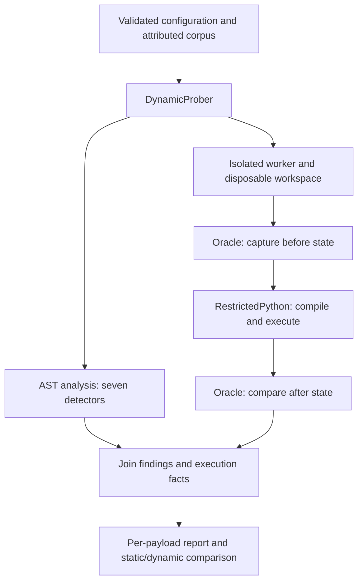

# SandboxEscapeFinder

Static analysis and isolated dynamic testing of Python sandbox escape techniques.
This is my implementation of [Task 6](https://github.com/SeekingDream/ProgrammingTask/blob/master/06_sandbox_escape_finder.md)
from the ProgrammingTask repository. The dynamic target is the real, unmodified
[RestrictedPython](https://github.com/zopefoundation/RestrictedPython) package.

The tool answers two questions: does a source snippet contain a known escape
pattern, and does running it produce an effect that the oracle can observe?
A static finding is evidence of suspicious syntax. A confirmed escape requires
an observed effect; an exception or successful execution alone is insufficient.

## Run with Docker

Install Docker Desktop, start it, and select **Linux containers**. Building needs
internet access to download the pinned image and dependencies. The run commands
below disable networking and do not mount your files or the Docker socket.

```powershell
git clone https://github.com/aynaakhann/sandbox_escape_finder.git
cd sandbox_escape_finder
docker build -t sandbox-escape-finder:latest .
docker run --rm --network none --read-only --tmpfs /tmp:rw,size=64m,mode=1777 --cap-drop ALL --security-opt no-new-privileges --memory 512m --cpus 1 --pids-limit 64 sandbox-escape-finder:latest
```

The default command runs the 19-case corpus and prints a summary, a per-payload
table, and the static/dynamic comparison. The container exits when it finishes;
this project is a command-line tool and has no web server or port to open.
Starting the image in Docker Desktop also runs the probe, but the terminal
command applies the additional containment settings shown above.

The default configuration uses subprocess workers **inside this Linux
container**. You do not need Docker inside Docker. Each worker gets a temporary
workspace and resource limits; the outer container supplies network and
filesystem isolation. RestrictedPython itself is not a complete OS sandbox.

Run the example, which demonstrates both public APIs and the comparison:

```powershell
docker run --rm --network none --read-only --tmpfs /tmp:rw,size=64m,mode=1777 --cap-drop ALL --security-opt no-new-privileges --memory 512m --cpus 1 --pids-limit 64 sandbox-escape-finder:latest python -I examples/quickstart.py
```

Save a machine-readable report in PowerShell:

```powershell
New-Item -ItemType Directory -Force reports | Out-Null
docker run --rm --network none --read-only --tmpfs /tmp:rw,size=64m,mode=1777 --cap-drop ALL --security-opt no-new-privileges --memory 512m --cpus 1 --pids-limit 64 sandbox-escape-finder:latest python -I -m sandbox_escape_finder.cli --config config/default.json probe --json | Out-File -Encoding utf8 reports/probe.json
$report = Get-Content -Raw reports/probe.json | ConvertFrom-Json
$report.summary
```

Check that `isolation_available` is true and `summary.inconclusive` is zero.
CLI exit code 0 means a report was produced; infrastructure failures can still
appear inside that report. JSON contains the full per-payload findings,
execution status, oracle verdict, provenance, and timing.

## How it works



### Where to change what

Package files below are in `sandbox_escape_finder/`. Search for the named
function or class to reach the relevant code; names remain useful as lines move.

| Change | File | Starting point |
|---|---|---|
| Run settings: enabled rules, seed, threshold, time limits | [config/default.json](config/default.json) | Corresponding JSON key; pass this file with `--config`. |
| Add or modify an AST detection rule | [detectors.py](sandbox_escape_finder/detectors.py#L178) | Detector class `analyze()`; register new rules in `ALL_DETECTORS`. |
| Parsing, confidence filtering, finding order | [analyzer.py](sandbox_escape_finder/analyzer.py#L69) | `StaticAnalyzer.analyze()` |
| Built-in payloads and their source attribution | [corpus.py](sandbox_escape_finder/corpus.py#L73) | `_builtin_cases()`, `_catalog_cases()`; `Corpus.add_custom()` handles extra cases. |
| Validate settings or change programmatic defaults | [config.py](sandbox_escape_finder/config.py#L91) | `Config` fields, `from_dict()`, `validate()` |
| Coordinate probes and classify outcomes | [prober.py](sandbox_escape_finder/prober.py#L142) | `DynamicProber.run_report()`, `_classify()`, `_compare()` |
| Worker timeouts, resource limits, Docker settings | [isolation.py](sandbox_escape_finder/isolation.py#L103) | `_apply_rlimits()`, `SubprocessIsolation`, `DockerIsolation` |
| Run one request inside its disposable workspace | [_worker.py](sandbox_escape_finder/_worker.py) | `_run()` |
| RestrictedPython execution policy and supplied guards | [runners.py](sandbox_escape_finder/runners.py#L50) | `RestrictedPythonSandbox._make_globals()`, `__call__()` |
| Decide whether an observed effect counts as an escape | [oracle.py](sandbox_escape_finder/oracle.py#L76) | `CanaryOracle.setup()`, `evaluate()`, `judge()` |
| Trusted custom sandbox/oracle functions | [adapters.py](sandbox_escape_finder/adapters.py#L31) | `CallableSandbox`, `CallableOracle` |
| Report formatting and comparison text | [reporting.py](sandbox_escape_finder/reporting.py) | `to_json()`, `payload_results_table()`, `false_positive_negative_analysis()` |
| Command-line options and command selection | [cli.py](sandbox_escape_finder/cli.py#L87) | `main()` and the `_cmd_*` handlers |
| Application or test image construction | [Dockerfile](Dockerfile) | Shared `app` stage, `test` output, default `runtime` output |

The public project has five folders: `sandbox_escape_finder/` contains the
application, `config/` its settings, `examples/` a usage demonstration, `tests/`
all automated checks, and `reports/` saved results. This README is the public
guide for running, testing, and understanding the submission.

## Public API and installation

The package requires Python 3.10 or newer. The tested Docker environment uses
CPython 3.13 and RestrictedPython 8.5. Runtime/build versions are pinned in
`pyproject.toml`; test constraints are in `requirements-test-lock.txt`.

For editable installation, run `python -m pip install -e .`. For test tools,
run `python -m pip install -c requirements-test-lock.txt -e ".[test]"`.
Use a virtual environment. On Windows, use Docker for dynamic execution;
the subprocess backend requires POSIX resource limits.

```python
from sandbox_escape_finder import (
    CanaryOracle, DynamicProber, RestrictedPythonSandbox, StaticAnalyzer,
    load_corpus,
)

config = {"seed": 1337, "isolation": {"mode": "docker"}}
# Build sandbox-escape-finder:latest first; Docker must be running.
findings = StaticAnalyzer(config).scan("x = (lambda: 0).__globals__")
prober = DynamicProber(RestrictedPythonSandbox(), CanaryOracle(), config)
report = prober.run(load_corpus(config))
assert isinstance(findings, list) and isinstance(report, list)
```

`scan()` returns `list[dict]` findings. `run()` accepts an iterable of source
strings or attributed corpus cases and returns `list[dict]` results. Each
result records static flags, execution status, oracle confirmation, and timing.
`analyze()` and `run_report()` provide richer objects for reporting helpers.

The Docker backend in this example runs on the host and starts a fresh
container for each case. The default CLI instead uses subprocesses inside the
outer container. Both paths are tested.

Custom sandbox/oracle hooks must be trusted importable module-level functions
available in the worker environment, including the image for Docker mode.
Closures, lambdas, and `__main__` functions are rejected in isolated modes.
The controlled in-process test mode needs an explicit opt-in.

## Detected techniques and target restrictions

The seven detectors inspect AST nodes, so comments and ordinary strings merely
mentioning dunder names are not matches. Confidence describes the syntax match,
not the probability that the code will escape.

| Detector | Technique | RestrictedPython behavior in the tested setup |
|---|---|---|
| `subclasses_traversal` | Follow class, base, MRO, or subclass links to other objects. | Leading-underscore attributes are rejected during restricted compilation. |
| `globals_access` | Recover a function's global namespace through `__globals__`. | Restricted compilation rejects the attribute. |
| `closure_cell` | Inspect a function's closure and captured cell contents. | Restricted compilation rejects `__closure__`. |
| `builtins_recovery` | Recover the builtins mapping or an import capability. | Dunder names are rejected; the supplied builtins omit unrestricted import. |
| `frame_introspection` | Reach generator frames, caller frames, or their globals. | Forbidden frame attributes are rejected and introspection helpers are not supplied. |
| `format_string_traversal` | Traverse attributes through a literal format template. | The runtime attribute guard blocks access to `str.format`. |
| `dangerous_builtin_call` | Call import/eval/exec or literal dunder `getattr` patterns. | Restricted compilation or the limited builtins block the tested calls. |

Each class has positive and negative unit tests. The corpus contains 12
catalog-derived probes, five additional checks, and two benign controls.
The [source and adaptation map](#corpus-sources) records which access
step was retained from each catalog. These are capability probes, not claims
that every case is a complete working exploit.

## Oracle design

Before execution, `CanaryOracle` creates `CANARY.txt` in a throwaway workspace
and records file hashes. After execution, it confirms an effect if an
`ESCAPE_MARKER` appears, the canary changes/disappears, or another file is
created/removed. No real host file is used as an escape target.

The tested RestrictedPython runner grants no filesystem access, so these effects
violate its intended policy. Tests use a deliberately broken toy runner to
establish that the oracle can detect a marker effect. This positive control
also checks that a later exception does not erase an already observed effect.

The oracle observes this workspace only. It does not detect pure information
disclosure or effects elsewhere, and it does not compare the contents of every
pre-existing file. A runner that permits legitimate file writes would need an
allowed-area policy. "No confirmed escape" means no observed effect under
this setup; it is not a proof that arbitrary Python code is safe.

## Results

Verified on **2026-10-18** with RestrictedPython **8.5** in Linux containers.
The saved [JSON report](reports/probe.json) contains the underlying observations.

| Measure | Result |
|---|---:|
| Corpus cases | 19 |
| Statically flagged | 14 |
| Compile rejected | 14 |
| Execution blocked | 3 |
| Benign completions | 2 |
| Confirmed escapes | 0 |
| Inconclusive outcomes | 0 |
| Static expectation mismatches | 0 |

The following table is generated from that report:

| Payload | Technique | Static flag | Dynamic outcome | Escape confirmed |
|---|---|:---:|---|:---:|
| `wrap_close_builtins` | Class initializer globals to builtins | yes | `compile_rejected` | no |
| `func_globals` | Function __globals__ access | yes | `compile_rejected` | no |
| `closure_cell` | Closure / cell introspection | yes | `compile_rejected` | no |
| `plain_import_os` | Plain import statement | no | `execution_blocked` | no |
| `import_name_call` | Direct __import__ call | yes | `compile_rejected` | no |
| `getattr_dunder` | Dunder getattr | yes | `execution_blocked` | no |
| `subclasses_popen` | __subclasses__ / MRO traversal | yes | `compile_rejected` | no |
| `generator_back_builtins` | Generator caller-frame builtins recovery | yes | `compile_rejected` | no |
| `builtins_subscript` | __builtins__ / built-ins recovery | yes | `compile_rejected` | no |
| `sys_modules_builtins` | sys.modules builtins import recovery | yes | `compile_rejected` | no |
| `frame_getframe` | Frame / execution-context introspection | yes | `compile_rejected` | no |
| `builtin_importer` | BuiltinImporter class discovery | yes | `compile_rejected` | no |
| `builtin_self` | Builtin function __self__ recovery | no | `compile_rejected` | no |
| `os_builtins_import` | Module builtins mapping import recovery | yes | `compile_rejected` | no |
| `format_string` | Format-string attribute traversal | yes | `execution_blocked` | no |
| `benign_arithmetic` | Benign arithmetic (control) | no | `execution_completed` | no |
| `generator_frame` | Generator-frame introspection | yes | `compile_rejected` | no |
| `benign_string_mentions_dunder` | String mentioning dunders (control) | no | `execution_completed` | no |
| `object_dict` | Object dictionary recovery | no | `compile_rejected` | no |

Fourteen cases were flagged but did not escape. These are suspicious techniques
contained by this target, so they are not automatically detector false positives.
No case escaped without a static flag. `builtin_self` and `object_dict` expose
static coverage gaps, although both were blocked dynamically. The tool also
reports inconclusive infrastructure outcomes separately. A contained toy-runner
test demonstrates the escaped-but-unflagged reporting path independently.

## Tests

The same Dockerfile builds both outputs. Its final `runtime` stage is the
default application image; selecting `test` adds pytest and the test directory.
The test image builds directly from the shared application stage, so it does
not depend on a separately tagged application image.

```powershell
docker build --target test -t sandbox-escape-finder:test .
docker run --rm --network none --read-only --tmpfs /tmp:rw,size=64m,mode=1777 --cap-drop ALL --security-opt no-new-privileges --memory 512m --cpus 1 --pids-limit 64 sandbox-escape-finder:test
```

Expected: **100 passed, 8 deselected**. This includes detector tests, oracle
positive/negative controls, API/configuration checks, the real full-corpus run,
and ten task acceptance checks in `tests/test_task6_requirements.py`.
To run just those ten, append
`python -m pytest -q tests/test_task6_requirements.py -p no:cacheprovider`
to the same `docker run` command, after the image name.

The other eight tests run pytest on the host and send their payloads to
disposable Docker workers. Build the application image using the command in
[Run with Docker](#run-with-docker) first, then run:

```powershell
python -m venv .venv
.\.venv\Scripts\python.exe -m pip install -c requirements-test-lock.txt -e ".[test]"
.\.venv\Scripts\python.exe -m pytest -q -m docker -p no:cacheprovider
```

Expected: **8 passed, 100 deselected**; together the two selections cover
**108 distinct tests**. Skips do not count as exercised tests.
The eight tests are deselected in the first run and selected in the second;
they are not eight missing tests. On Windows, use the displayed `-m docker`
selection; the other dynamic tests need Linux resource limits.

Saved test outputs are [the Linux log](reports/pytest-container.txt) and
[the Docker-backend log](reports/pytest-docker-backend.txt). To record a new
run in PowerShell, append
`2>&1 | Tee-Object -FilePath reports/pytest-container.txt` or the corresponding
Docker-backend filename, then inspect `$LASTEXITCODE` (expected: `0`).

| Task requirement | Where it is checked |
|---|---|
| Named AST techniques with locations and confidence | `tests/test_detectors.py`: positive/negative cases, source positions, and syntax handling. |
| Required API, thresholds, and callable hooks | `tests/test_api_contract.py` and `tests/test_task6_requirements.py`. |
| Automated oracle with a deliberately broken fixture | `tests/test_oracle.py` and the contained effect-before-exception controls. |
| Real unmodified RestrictedPython and isolated full-corpus run | `tests/test_integration.py` and `tests/test_integration_docker.py`. |
| Attributed corpus, custom inputs, reproducible seed, and comparison | `tests/test_prober.py` and `tests/test_task6_requirements.py`; manually review each source adaptation below. |
| Installable package and executable example | Docker builds exercise normal/editable installation; the quickstart demonstrates the API. |

The tests check overlapping properties, not 108 different requirements.
Explaining the code and its limitations remains part of the human review.

## Configuration and limits

Pass the JSON configuration before the CLI subcommand:
`python -I -m sandbox_escape_finder.cli --config config/default.json probe`.

| Setting | Purpose |
|---|---|
| `enabled_detectors` | Select detector IDs from the table above. |
| `enabled_categories` | Filter corpus categories; `null` includes all. |
| `custom_payloads` | Add cases with `id` and `source`, plus optional metadata. |
| `seed` | Reproduce corpus ordering; timings still vary. |
| `min_confidence` | Inclusive static threshold in [0, 1]; does not skip dynamic probes. |
| `timeout_seconds`, `resource_limits` | Bound worker time and available resources. |
| `isolation.mode` | `subprocess`, `docker`, or explicitly opted-in `inprocess`. |
| `isolation.allow_in_process` | Required explicit gate for controlled in-process tests. |
| `isolation.require_isolation` | Retained configuration field; unavailable backends never trigger a weaker fallback. |
| `isolation.allow_network` | Retained field; does not grant Docker network access or itself block a subprocess network. |
| `reporting` | Stored formatting preferences; current CLI helpers use their own defaults. |

The AST detectors do not resolve arbitrary string construction, aliases, or
runtime-generated attributes. Subprocess resource limits alone do not isolate
networking or the host filesystem; use the documented outer Docker run.
The standard test container needs no Docker socket, and custom hooks require
trusted code to be present in the worker environment. The reported outcomes
apply to this pinned dependency version and supplied execution policy.

## Corpus sources

Reviewed on 2026-10-18 against the two catalogs named by Task 6.
Probes are reduced capability tests, rather than claims of working exploits.
The reductions keep the relevant Python access step and omit shell execution,
external targets, and dependencies that are unnecessary to test rejection.

The corpus has **19 cases**: **12 catalog-derived probes**, 5 additional
technique/control probes, and 2 benign controls. Each source string is unique.
The metadata in `corpus.py` contains the source URL and adaptation for each case.

| Catalog-derived case | Inspected source | Adaptation |
|---|---|---|
| `subclasses_popen` | [pyjailbreaker README example](https://github.com/jailctf/pyjailbreaker#example) | Keep subclass enumeration; use `__bases__[0]` in place of `__base__`; omit shell steps. The historical ID names a capability target, not an executed Popen call. |
| `func_globals` | [sys.py: sys__wrap_close](https://github.com/jailctf/pyjailbreaker/blob/main/jailbreak/gadgets/python/sys.py) | Isolate function-global access using a local lambda rather than locating a class initializer. |
| `builtins_subscript` | [Kaplan example.py](https://github.com/moshekaplan/python_sandbox_escapes/blob/master/example.py) | Reduce the `os.__builtins__` recovery example to the mapping lookup, without importing. |
| `generator_frame` | [builtins_dict.py: builtins_dict__gi_builtins](https://github.com/jailctf/pyjailbreaker/blob/main/jailbreak/gadgets/python/builtins_dict.py) | Reduce generator-frame traversal to reading its globals. |
| `import_name_call` | [Kaplan example.py](https://github.com/moshekaplan/python_sandbox_escapes/blob/master/example.py) | Keep the direct-import bypass; use local standard-library `os` instead of the example's placeholder module. |
| `builtin_self` | [builtins_dict.py: builtins_dict__self](https://github.com/jailctf/pyjailbreaker/blob/main/jailbreak/gadgets/python/builtins_dict.py) | Probe `chr.__self__`; it is blocked dynamically and currently unflagged statically. |
| `wrap_close_builtins` | [builtins_dict.py: builtins_dict__wrap_close](https://github.com/jailctf/pyjailbreaker/blob/main/jailbreak/gadgets/python/builtins_dict.py) | Inline the class-list dependency and stop at the recovered builtins mapping. |
| `sys_modules_builtins` | [Kaplan example.py](https://github.com/moshekaplan/python_sandbox_escapes/blob/master/example.py) | Update Python 2 `__builtin__` to Python 3 `builtins`; target the local `sys` module. |
| `os_builtins_import` | [Kaplan example.py](https://github.com/moshekaplan/python_sandbox_escapes/blob/master/example.py) | Retain the module-builtins import chain; use the local `sys` module. |
| `builtin_importer` | [import_builtin_module.py: import_builtin_module__builtinimporter](https://github.com/jailctf/pyjailbreaker/blob/main/jailbreak/gadgets/python/import_builtin_module.py) | Inline subclass enumeration and request the local `sys` module; no command execution. |
| `object_dict` | [get_obj_dict.py: get_obj_dict__basic](https://github.com/jailctf/pyjailbreaker/blob/main/jailbreak/gadgets/python/get_obj_dict.py) | Apply the object-dictionary access step to a local function; currently unflagged statically. |
| `generator_back_builtins` | [builtins_dict.py: builtins_dict__gi_builtins](https://github.com/jailctf/pyjailbreaker/blob/main/jailbreak/gadgets/python/builtins_dict.py) | Retain caller-frame traversal and builtins access; assign the recovered value instead of returning it from a gadget. |

`closure_cell`, `frame_getframe`, `format_string`, `getattr_dunder`, and
`plain_import_os` are additional checks written for this package. Their metadata
does not claim derivation from a catalog. The two benign cases check arithmetic
and a string merely mentioning dunder names.

The corpus spans several access steps within related chains. Twelve probes do
not mean twelve distinct vulnerability classes. The detector suite separately
tests seven named technique classes with positive and negative examples.

The two unflagged catalog access steps are documented static coverage limits;
they do not escape RestrictedPython in the tested configuration. The dynamic
report preserves that distinction rather than changing expectations to claim
the static analyzer detects every possible technique.

## References and license

- [Task specification](https://github.com/SeekingDream/ProgrammingTask/blob/master/06_sandbox_escape_finder.md)
- [RestrictedPython documentation](https://restrictedpython.readthedocs.io/)
- [pyjailbreaker catalog](https://github.com/jailctf/pyjailbreaker)
- [Python sandbox escapes catalog](https://github.com/moshekaplan/python_sandbox_escapes)
- [Per-payload attribution](#corpus-sources)

The project uses the [MIT license](LICENSE). External catalogs and dependencies
retain their own licenses and attribution.
