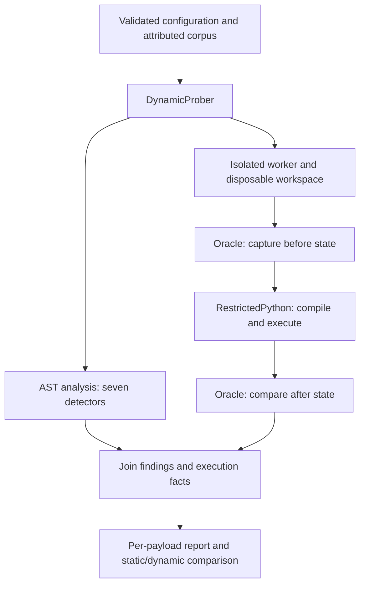

# SandboxEscapeFinder

Static analysis and isolated dynamic testing of Python sandbox escape techniques.
This is my implementation of [Task 6](https://github.com/SeekingDream/ProgrammingTask/blob/master/06_sandbox_escape_finder.md)
from the ProgrammingTask repository. The dynamic target is the real, unmodified
[RestrictedPython](https://github.com/zopefoundation/RestrictedPython) package.

The tool answers two questions: does a source snippet contain a known escape
pattern, and does running it produce an effect that the oracle can observe?
A static finding is evidence of suspicious syntax. A confirmed escape requires
an observed effect; an exception or successful execution alone is insufficient.

## Run with Docker

Install Docker Desktop, start it, and select **Linux containers**. Building needs
internet access to download the pinned image and dependencies. The run commands
below disable networking and do not mount your files or the Docker socket.

```powershell
git clone https://github.com/aynaakhann/sandbox_escape_finder.git
cd sandbox_escape_finder
docker build -t sandbox-escape-finder:latest .
docker run --rm --network none --read-only --tmpfs /tmp:rw,size=64m,mode=1777 --cap-drop ALL --security-opt no-new-privileges --memory 512m --cpus 1 --pids-limit 64 sandbox-escape-finder:latest
```

The default command runs the 19-case corpus and prints a summary, a per-payload
table, and the static/dynamic comparison. The container exits when it finishes;
this project is a command-line tool and has no web server or port to open.
Starting the image in Docker Desktop also runs the probe, but the terminal
command applies the additional containment settings shown above.

The default configuration uses subprocess workers **inside this Linux
container**. You do not need Docker inside Docker. Each worker gets a temporary
workspace and resource limits; the outer container supplies network and
filesystem isolation. RestrictedPython itself is not a complete OS sandbox.

Run the example, which demonstrates both public APIs and the comparison:

```powershell
docker run --rm --network none --read-only --tmpfs /tmp:rw,size=64m,mode=1777 --cap-drop ALL --security-opt no-new-privileges --memory 512m --cpus 1 --pids-limit 64 sandbox-escape-finder:latest python -I examples/quickstart.py
```

Save a machine-readable report in PowerShell:

```powershell
New-Item -ItemType Directory -Force reports | Out-Null
docker run --rm --network none --read-only --tmpfs /tmp:rw,size=64m,mode=1777 --cap-drop ALL --security-opt no-new-privileges --memory 512m --cpus 1 --pids-limit 64 sandbox-escape-finder:latest python -I -m sandbox_escape_finder.cli --config config/default.json probe --json | Out-File -Encoding utf8 reports/probe.json
$report = Get-Content -Raw reports/probe.json | ConvertFrom-Json
$report.summary
```

Check that `isolation_available` is true and `summary.inconclusive` is zero.
CLI exit code 0 means a report was produced; infrastructure failures can still
appear inside that report. JSON contains the full per-payload findings,
execution status, oracle verdict, provenance, and timing.

## How it works



| File | Responsibility |
|---|---|
| `analyzer.py`, `detectors.py` | Parse Python ASTs; return technique, location, node type, and confidence. |
| `corpus.py` | Store attributed probes and load configured custom cases. |
| `config.py` | Validate detector names, categories, thresholds, limits, and isolation settings. |
| `prober.py` | Run each case and combine static findings with dynamic observations. |
| `isolation.py`, `_worker.py` | Start workers, apply limits, and use the JSON request/response protocol. |
| `runners.py`, `adapters.py` | Construct the RestrictedPython runner and trusted callable hooks. |
| `oracle.py` | Capture workspace state and judge observable filesystem effects. |
| `reporting.py`, `cli.py` | Render JSON, results tables, summaries, and the comparison. |

All package files are under `sandbox_escape_finder/`. The remaining directories
are `config/`, `examples/`, `tests/`, `validation/`, `docs/`, and `reports/`.

## Public API and installation

The package requires Python 3.10 or newer. The tested Docker environment uses
CPython 3.13 and RestrictedPython 8.5. Runtime/build versions are pinned in
`pyproject.toml`; test constraints are in `requirements-test-lock.txt`.

For editable installation, run `python -m pip install -e .`. For test tools,
run `python -m pip install -c requirements-test-lock.txt -e ".[test]"`.
Use a virtual environment. On Windows, use Docker for dynamic execution;
the subprocess backend requires POSIX resource limits.

```python
from sandbox_escape_finder import (
    CanaryOracle, DynamicProber, RestrictedPythonSandbox, StaticAnalyzer,
    load_corpus,
)

config = {"seed": 1337, "isolation": {"mode": "docker"}}
# Build sandbox-escape-finder:latest first; Docker must be running.
findings = StaticAnalyzer(config).scan("x = (lambda: 0).__globals__")
prober = DynamicProber(RestrictedPythonSandbox(), CanaryOracle(), config)
report = prober.run(load_corpus(config))
assert isinstance(findings, list) and isinstance(report, list)
```

`scan()` returns `list[dict]` findings. `run()` accepts an iterable of source
strings or attributed corpus cases and returns `list[dict]` results. Each
result records static flags, execution status, oracle confirmation, and timing.
`analyze()` and `run_report()` provide richer objects for reporting helpers.

The Docker backend in this example runs on the host and starts a fresh
container for each case. The default CLI instead uses subprocesses inside the
outer container. Both paths are tested.

Custom sandbox/oracle hooks must be trusted importable module-level functions
available in the worker environment, including the image for Docker mode.
Closures, lambdas, and `__main__` functions are rejected in isolated modes.
The controlled in-process test mode needs an explicit opt-in.

## Detected techniques and target restrictions

The seven detectors inspect AST nodes, so comments and ordinary strings merely
mentioning dunder names are not matches. Confidence describes the syntax match,
not the probability that the code will escape.

| Detector | Technique | RestrictedPython behavior in the tested setup |
|---|---|---|
| `subclasses_traversal` | Follow class, base, MRO, or subclass links to other objects. | Leading-underscore attributes are rejected during restricted compilation. |
| `globals_access` | Recover a function's global namespace through `__globals__`. | Restricted compilation rejects the attribute. |
| `closure_cell` | Inspect a function's closure and captured cell contents. | Restricted compilation rejects `__closure__`. |
| `builtins_recovery` | Recover the builtins mapping or an import capability. | Dunder names are rejected; the supplied builtins omit unrestricted import. |
| `frame_introspection` | Reach generator frames, caller frames, or their globals. | Forbidden frame attributes are rejected and introspection helpers are not supplied. |
| `format_string_traversal` | Traverse attributes through a literal format template. | The runtime attribute guard blocks access to `str.format`. |
| `dangerous_builtin_call` | Call import/eval/exec or literal dunder `getattr` patterns. | Restricted compilation or the limited builtins block the tested calls. |

Each class has positive and negative unit tests. The corpus contains 12
catalog-derived probes, five additional checks, and two benign controls.
The [source and adaptation map](docs/CORPUS_SOURCES.md) records which access
step was retained from each catalog. These are capability probes, not claims
that every case is a complete working exploit.

## Oracle design

Before execution, `CanaryOracle` creates `CANARY.txt` in a throwaway workspace
and records file hashes. After execution, it confirms an effect if an
`ESCAPE_MARKER` appears, the canary changes/disappears, or another file is
created/removed. No real host file is used as an escape target.

The tested RestrictedPython runner grants no filesystem access, so these effects
violate its intended policy. Tests use a deliberately broken toy runner to
establish that the oracle can detect a marker effect. This positive control
also checks that a later exception does not erase an already observed effect.

The oracle observes this workspace only. It does not detect pure information
disclosure or effects elsewhere, and it does not compare the contents of every
pre-existing file. A runner that permits legitimate file writes would need an
allowed-area policy. "No confirmed escape" means no observed effect under
this setup; it is not a proof that arbitrary Python code is safe.

## Results

Verified on **2026-10-18** with RestrictedPython **8.5** in Linux containers.
The saved [JSON report](reports/probe.json) contains the underlying observations.

| Measure | Result |
|---|---:|
| Corpus cases | 19 |
| Statically flagged | 14 |
| Compile rejected | 14 |
| Execution blocked | 3 |
| Benign completions | 2 |
| Confirmed escapes | 0 |
| Inconclusive outcomes | 0 |
| Static expectation mismatches | 0 |

The following table is generated from that report:

| Payload | Technique | Static flag | Dynamic outcome | Escape confirmed |
|---|---|:---:|---|:---:|
| `wrap_close_builtins` | Class initializer globals to builtins | yes | `compile_rejected` | no |
| `func_globals` | Function __globals__ access | yes | `compile_rejected` | no |
| `closure_cell` | Closure / cell introspection | yes | `compile_rejected` | no |
| `plain_import_os` | Plain import statement | no | `execution_blocked` | no |
| `import_name_call` | Direct __import__ call | yes | `compile_rejected` | no |
| `getattr_dunder` | Dunder getattr | yes | `execution_blocked` | no |
| `subclasses_popen` | __subclasses__ / MRO traversal | yes | `compile_rejected` | no |
| `generator_back_builtins` | Generator caller-frame builtins recovery | yes | `compile_rejected` | no |
| `builtins_subscript` | __builtins__ / built-ins recovery | yes | `compile_rejected` | no |
| `sys_modules_builtins` | sys.modules builtins import recovery | yes | `compile_rejected` | no |
| `frame_getframe` | Frame / execution-context introspection | yes | `compile_rejected` | no |
| `builtin_importer` | BuiltinImporter class discovery | yes | `compile_rejected` | no |
| `builtin_self` | Builtin function __self__ recovery | no | `compile_rejected` | no |
| `os_builtins_import` | Module builtins mapping import recovery | yes | `compile_rejected` | no |
| `format_string` | Format-string attribute traversal | yes | `execution_blocked` | no |
| `benign_arithmetic` | Benign arithmetic (control) | no | `execution_completed` | no |
| `generator_frame` | Generator-frame introspection | yes | `compile_rejected` | no |
| `benign_string_mentions_dunder` | String mentioning dunders (control) | no | `execution_completed` | no |
| `object_dict` | Object dictionary recovery | no | `compile_rejected` | no |

Fourteen cases were flagged but did not escape. These are suspicious techniques
contained by this target, so they are not automatically detector false positives.
No case escaped without a static flag. `builtin_self` and `object_dict` expose
static coverage gaps, although both were blocked dynamically. The tool also
reports inconclusive infrastructure outcomes separately. A contained toy-runner
test demonstrates the escaped-but-unflagged reporting path independently.

## Tests

Build the application image first, then the test image:

```powershell
docker build -f Dockerfile.test -t sandbox-escape-finder:test .
docker run --rm --network none --read-only --tmpfs /tmp:rw,size=64m,mode=1777 --cap-drop ALL --security-opt no-new-privileges --memory 512m --cpus 1 --pids-limit 64 sandbox-escape-finder:test
```

Expected: **100 passed, 8 deselected**. This includes detector tests, oracle
positive/negative controls, API/configuration checks, the real full-corpus run,
and ten task acceptance checks. The other eight tests run pytest on the host
and send their payloads to disposable Docker workers:

```powershell
python -m venv .venv
.\.venv\Scripts\python.exe -m pip install -c requirements-test-lock.txt -e ".[test]"
.\.venv\Scripts\python.exe -m pytest -q -m docker -p no:cacheprovider
```

Expected: **8 passed, 100 deselected**; together the two selections cover
**108 distinct tests**. Skips do not count as exercised tests.
See [testing details](docs/TASK6_TESTING.md) for individual checks and evidence.

## Configuration and limits

Pass the JSON configuration before the CLI subcommand:
`python -I -m sandbox_escape_finder.cli --config config/default.json probe`.

| Setting | Purpose |
|---|---|
| `enabled_detectors` | Select detector IDs from the table above. |
| `enabled_categories` | Filter corpus categories; `null` includes all. |
| `custom_payloads` | Add cases with `id` and `source`, plus optional metadata. |
| `seed` | Reproduce corpus ordering; timings still vary. |
| `min_confidence` | Inclusive static threshold in [0, 1]; does not skip dynamic probes. |
| `timeout_seconds`, `resource_limits` | Bound worker time and available resources. |
| `isolation.mode` | `subprocess`, `docker`, or explicitly opted-in `inprocess`. |
| `isolation.allow_in_process` | Required explicit gate for controlled in-process tests. |
| `isolation.require_isolation` | Retained configuration field; unavailable backends never trigger a weaker fallback. |
| `isolation.allow_network` | Retained field; does not grant Docker network access or itself block a subprocess network. |
| `reporting` | Stored formatting preferences; current CLI helpers use their own defaults. |

The AST detectors do not resolve arbitrary string construction, aliases, or
runtime-generated attributes. Subprocess resource limits alone do not isolate
networking or the host filesystem; use the documented outer Docker run.
The standard test container needs no Docker socket, and custom hooks require
trusted code to be present in the worker environment. The reported outcomes
apply to this pinned dependency version and supplied execution policy.

## References and license

- [Task specification](https://github.com/SeekingDream/ProgrammingTask/blob/master/06_sandbox_escape_finder.md)
- [RestrictedPython documentation](https://restrictedpython.readthedocs.io/)
- [pyjailbreaker catalog](https://github.com/jailctf/pyjailbreaker)
- [Python sandbox escapes catalog](https://github.com/moshekaplan/python_sandbox_escapes)
- [Per-payload attribution](docs/CORPUS_SOURCES.md)

The project uses the [MIT license](LICENSE). External catalogs and dependencies
retain their own licenses and attribution.
